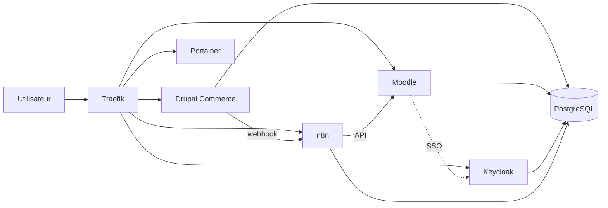

# CR465 — Plateforme pédagogique conteneurisée sécurisée

Travail de session (Polytechnique Montréal, CR465 Groupe D). Plateforme multi-services conteneurisée et déployée avec Docker Compose sur une VM Linux initialisée par cloud-init (VM as Code).

**Parcours métier:** achat d'une formation dans Drupal Commerce &rarr; accès automatique attribué dans Moodle (connexion via Keycloak)

> **Livrable:** [Gitbook](lien?) · [Vidéo](lien) \
>**Référence** : l'énoncé et les grilles fournis par l'enseignant sont dans `md/`.
> **Notre documentation** : technique dans `docs/`, livrable GitBook dans `gitbook/`.

## Architecture en bref


Seul Traefik est exposé: les services applicatifs et PostgreSQL restent en interne.

Schémas détaillés : `docs/architecture/01-architecture-generale.md`

## Pile technique

Traefik · Drupal Commerce · Moodle · Keycloak · n8n · PostgreSQL
· Portainer CE \
**Bonus / Optionnel** : Redis, Grafana + Loki, OpenAppSec, gVisor.

## Prérequis (poste de développement)
- Git
- Multipass
- Un éditeur

**Docker est installé _dans la VM_** par cloud-init.

## Démarrage rapide
```bash
# 1. Créer la VM (VM as Code)
multipass launch 24.04 --name plateforme --cpus 4 --memory 8G --disk 60G \
  --cloud-init cloud-init/user-data.yaml

# 2. Configurer les secrets (jamais commités)
cp compose/.env.example compose/.env   # puis remplir compose/.env

# 3. Déployer la stack
docker compose -f compose/docker-compose.yml up -d
```

## Structure du dépôt

| Dossier | Contenu |
|---|---|
| `cloud-init/` | VM as Code (`user-data.yaml`) |
| `compose/` | stack Docker Compose et configurations des services |
| `docs/` | documentation technique (architecture, sécurité, opérations, tests) |
| `gitbook/` | documentation GitBook (livrable) |
| `md/` | énoncé et grilles de référence (fournis) |
| `scripts/` | création/destruction de la VM, déploiment, tests, validation |
| `media/` | captures et ressources de la vidéo |

## Équipe et contributions
Détails `md/Contributions.md`.

| Membre | Rôle | Branche |
|---|---|---|
| (Nom) | Rôle | Projet-CR465-D|
| … | … | … |

## Sécurité du dépôt
Aucun secret n'est commité: seul `compose/.env.example` (valeurs factices) est versionné. \
`.env` est dans `.gitignore`.