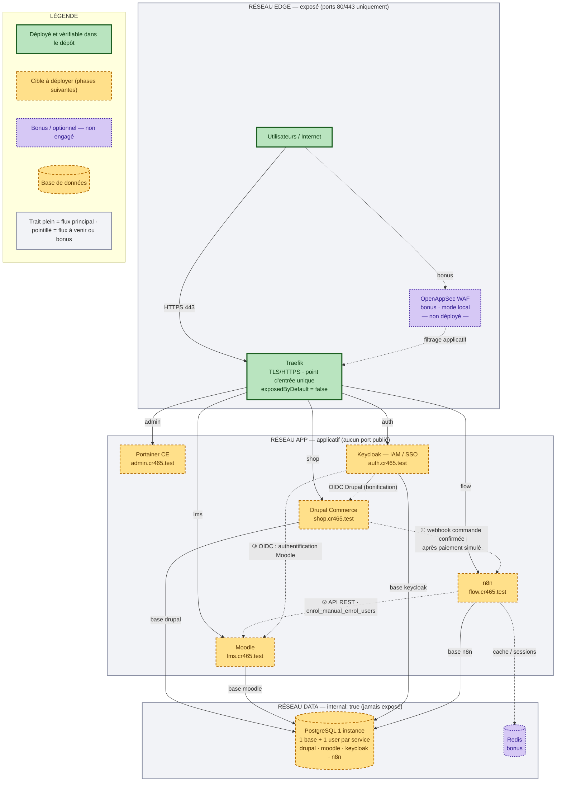

# Schéma 1 — Architecture générale

> **État au 19 octobre 2026.** Déployé et vérifié dans le dépôt : Traefik + un service de test
> (`whoami`). Tout le reste est une **cible** : les éléments non encore déployés sont en
> pointillé et signalés « non déployé ». Mettre ce schéma à jour à chaque ajout réel de service.

**Objectif** : montrer le parcours métier complet (achat → automatisation → accès au cours),
les points d'exposition et la place de chaque service.

## Lecture du schéma

- **Une seule porte d'entrée** : Traefik, en HTTPS. Aucun service n'est exposé directement.
- **Cinq services applicatifs** derrière la porte, chacun sur son sous-domaine.
- **PostgreSQL** en bas : jamais joignable depuis Internet, une base et un utilisateur par service.
- **Parcours métier** : ① achat → webhook · ② inscription via l'API Moodle · ③ authentification OIDC.
- **Trois états** : vert = déployé, jaune = cible, violet = bonus non engagé.

## Points d'attention

- Le WAF (bonus, +2 pts hors total) est **non déployé** : il reste en pointillé.
- Le SSO Drupal est une **bonification** : il n'est pas requis pour la note de base.
