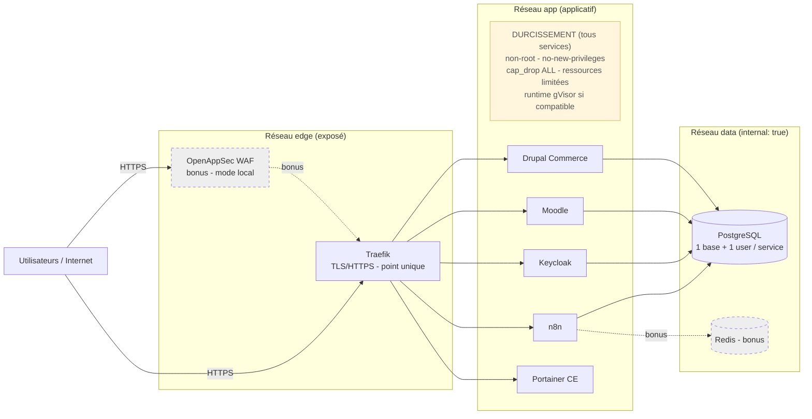

# Segmentation réseau — v2 (enrichie)

> Trois réseaux Docker isolés. Seul Traefik est exposé à Internet.
> Le réseau « data » est en `internal: true` : aucun accès depuis l'extérieur.
> La zone jaune rappelle le durcissement appliqué à chaque service applicatif.

