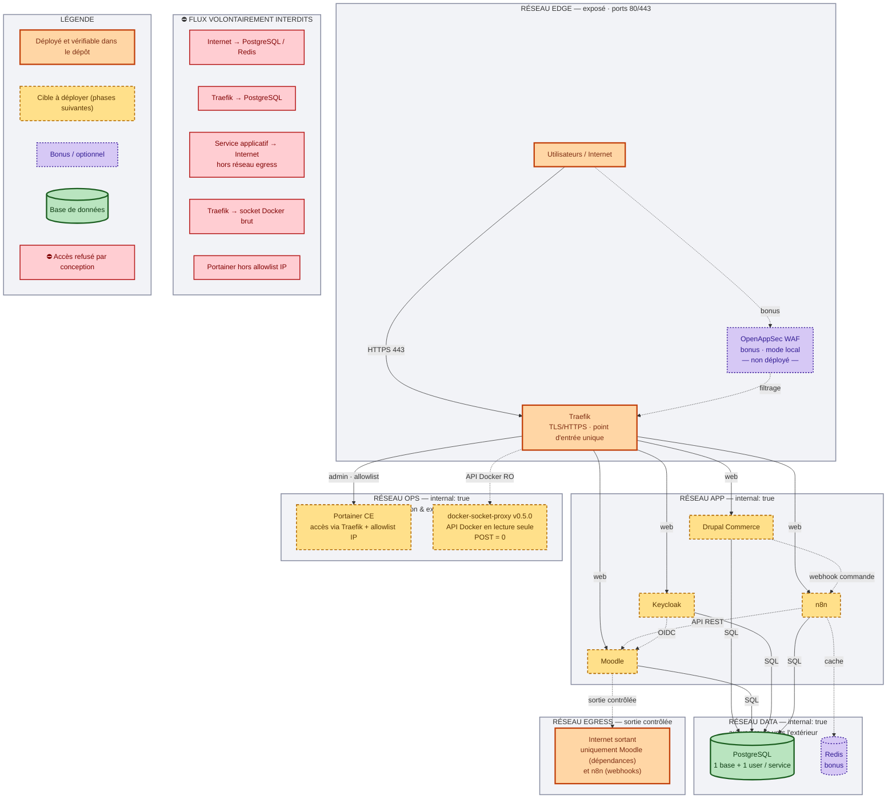

# Schéma 2 — Segmentation réseau

> **État au 19 octobre 2026.** Les neuf services sont déployés et vérifiés (le service de test
> `whoami` a été retiré). Les éléments encore non déployés — WAF, Redis, Loki — restent en
> pointillé. Mettre ce schéma à jour à chaque ajout réel de service.

**Objectif** : démontrer que les services sont isolés en zones de confiance, et expliciter
**quels accès sont volontairement interdits** — exigence directe de l'énoncé.

## Les quatre zones

| Zone | Contenu | Règle |
|---|---|---|
| `edge` | Traefik (+ WAF bonus) | Seule zone avec des ports publiés (80/443) |
| `app` | Drupal, Moodle, Keycloak, n8n | `internal: true` — aucune sortie Internet |
| `ops` | Portainer, socket-proxy | Administration isolée, accès restreint par IP |
| `data` | PostgreSQL (+ Redis bonus) | `internal: true`, jamais exposé, jamais routé par Traefik |
| `socket` | Traefik ↔ socket-proxy, Portainer ↔ socket-proxy-admin | `internal: true` |
| `egress` | Moodle, n8n | **Sortie Internet contrôlée** : seuls les services qui en ont besoin |

## Flux volontairement interdits

1. Internet → PostgreSQL / Redis
2. Traefik → PostgreSQL
3. Service applicatif → Internet **hors réseau `egress`** (les autres réseaux sont `internal: true`)
4. Traefik → socket Docker brut (passage obligé par le socket-proxy, en lecture seule)
5. Portainer hors de la liste d'IP autorisées

## État d'implémentation (mis à jour)

| Élément | État |
|---|---|
| `app` en `internal: true` | ✅ appliqué dans `compose/docker-compose.yml` |
| `data` en `internal: true` | ✅ appliqué |
| Réseau `socket` + `docker-socket-proxy` (`POST: 0`) | ✅ appliqué |
| Portainer restreint par IP | 🔶 à faire au déploiement de Portainer |

**Exception documentée** : Moodle a besoin d'Internet **pendant son installation** (dépendances
Composer) et n8n en aura besoin pour ses webhooks sortants. Un réseau `egress` dédié a donc été
créé et n'est rattaché qu'à ces deux services. Les autres restent strictement internes.
