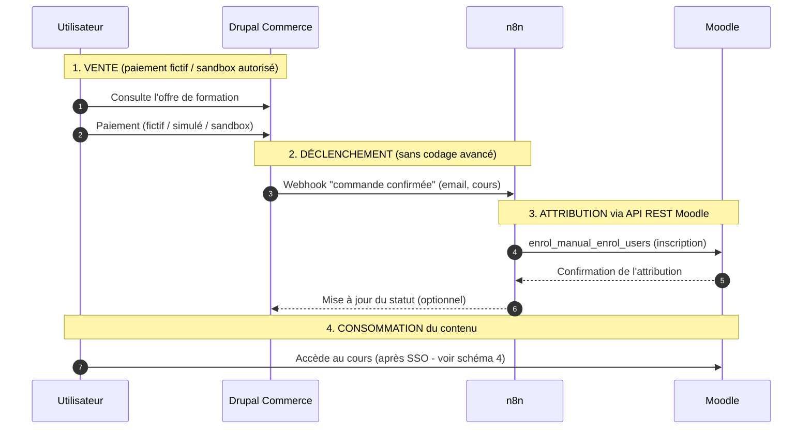

# Séquence d'intégration — Drupal Commerce → n8n → Moodle (v2)

> Flux d'attribution d'accès après un achat (paiement fictif/sandbox autorisé).
> Les 4 phases (VENTE, DÉCLENCHEMENT, ATTRIBUTION, CONSOMMATION) sont annotées.

