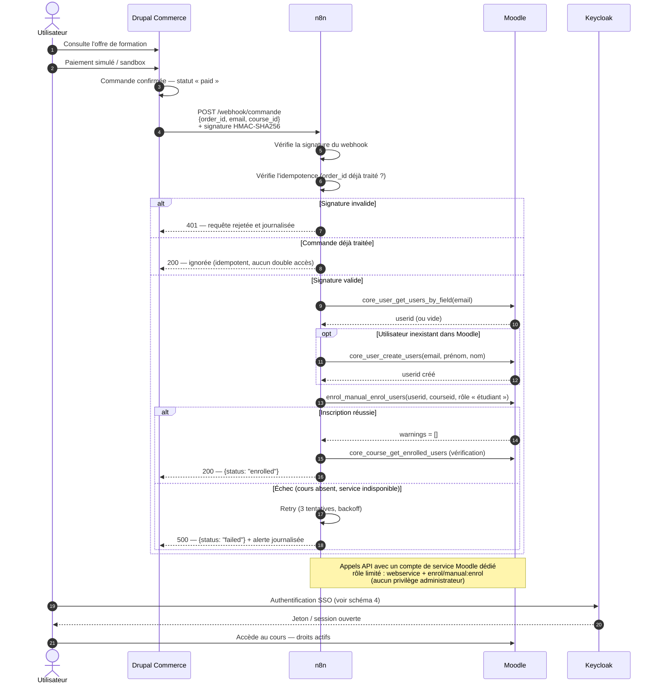

# Schéma 3 — Séquence d'intégration Drupal Commerce → n8n → Moodle

> **État au 19 octobre 2026.** Les neuf services sont déployés et vérifiés (le service de test
> `whoami` a été retiré). Les éléments encore non déployés — WAF, Redis, Loki — restent en
> pointillé. Mettre ce schéma à jour à chaque ajout réel de service.

**Objectif** : démontrer le parcours fonctionnel exigé, avec ses contrôles de sécurité.

## Ce que le schéma démontre

| Élément | Pourquoi |
|---|---|
| Webhook **signé HMAC-SHA256** | Empêche un tiers de déclencher des inscriptions |
| **Idempotence** sur `order_id` | Un webhook rejoué ne crée pas de double accès |
| Résolution `email → userid` | `enrol_manual_enrol_users` exige un `userid`, pas un email |
| Création du compte si absent | Cas d'un achat avant la première connexion SSO |
| **Compte de service** à rôle limité | Moindre privilège : `webservice` + `enrol/manual:enrol` |
| Retry ×3 + erreur journalisée | Un client qui a payé ne doit pas rester sans accès |
| Appel de vérification | Prouve que l'inscription a réellement pris effet |

## Fonctions Moodle utilisées (vérifiables dans la documentation officielle)

`core_user_get_users_by_field` · `core_user_create_users` · `enrol_manual_enrol_users` · `core_course_get_enrolled_users`

## Décision à trancher

**Qui crée le compte Moodle ?** n8n à l'achat, ou le SSO à la première connexion — **jamais les deux**
(risque de doublons). Choix recommandé : n8n crée, le SSO rattache par courriel.
