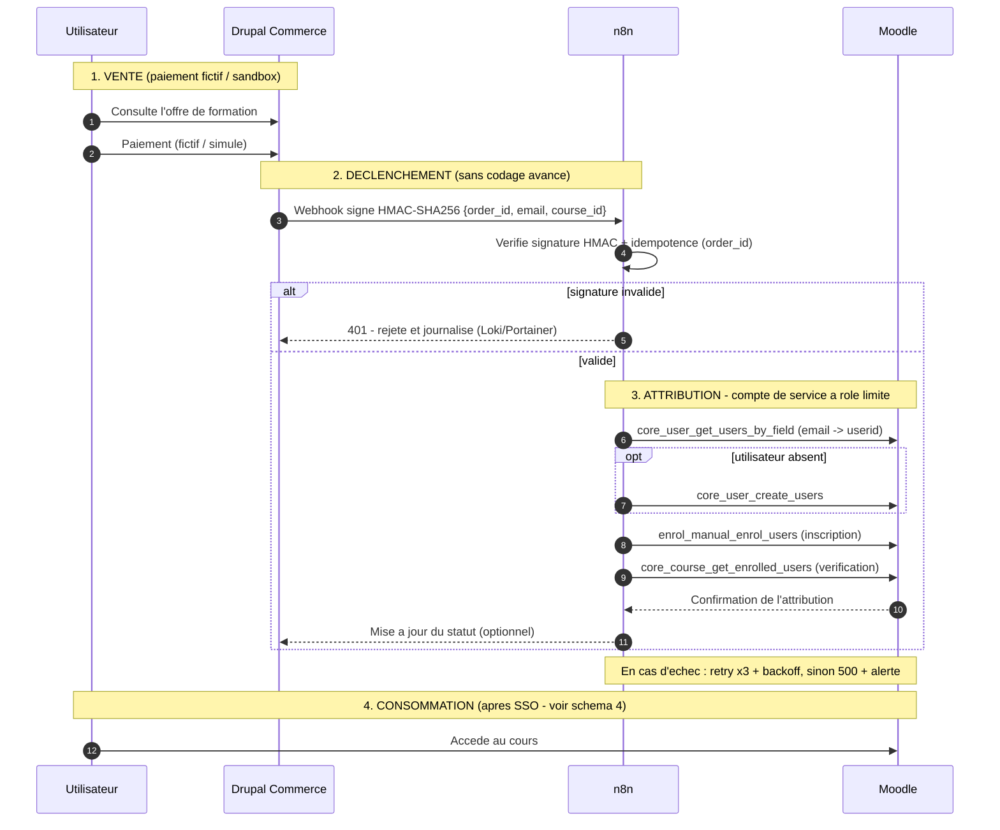

# Séquence d'intégration — Drupal Commerce → n8n → Moodle (v4)
 
> Flux d'attribution d'accès après achat (paiement fictif/sandbox autorisé).
> Sécurités démontrées : webhook signé (HMAC), anti-rejeu (idempotence),
> moindre privilège (compte de service), gestion d'erreur (retry).
> Fonctions Moodle réelles et vérifiables dans la référence des services web.
 

## Lecture du schéma

| Mécanisme | Ce qu'il fait | Menace couverte |
|---|---|---|
| Webhook signé HMAC-SHA256 | Drupal signe le message avec un secret partagé, n8n vérifie la signature | Quelqu'un qui connaît l'URL de n8n déclenche de fausses inscriptions |
| Idempotence (`order_id`) | Une commande déjà traitée n'est pas rejouée | Webhook envoyé deux fois, rejeu d'une requête interceptée |
| Compte de service à rôle limité | n8n utilise un compte Moodle qui ne peut que gérer les inscriptions | Compromission de n8n = accès administrateur à Moodle |
| Retry ×3 avec backoff, puis alerte | Les pannes temporaires ne perdent pas la commande | Moodle indisponible au moment de l'achat |
| Rejet 401 journalisé | Les signatures invalides sont refusées et tracées | Tentatives d'abus, utile pour l'investigation |

**Appels Moodle utilisés :** `core_user_get_users_by_field` (trouver l'utilisateur
par email), `core_user_create_users` (le créer s'il n'existe pas),
`enrol_manual_enrol_users` (l'inscrire), `core_course_get_enrolled_users`
(vérifier l'inscription).

<!-- ? Détails du workflow et captures : voir `gitbook/projet-realisation/08-workflow-n8n.md`. ? -->