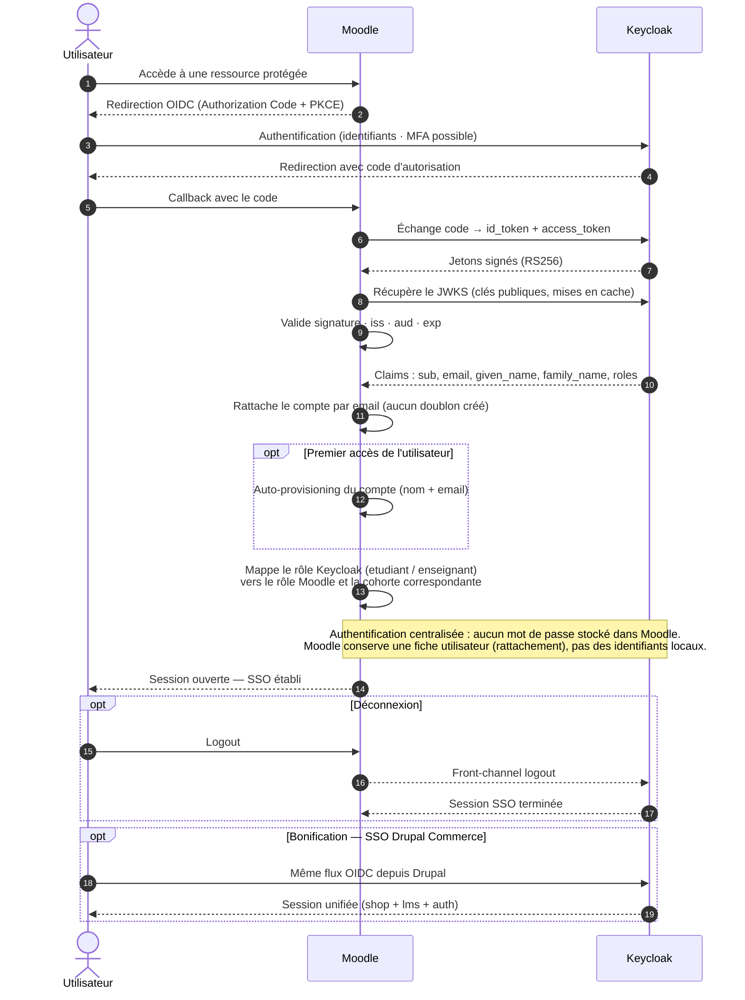

# Schéma 4 — Séquence SSO (Keycloak ↔ Moodle)

> **État au 19 octobre 2026.** Les neuf services sont déployés et vérifiés (le service de test
> `whoami` a été retiré). Les éléments encore non déployés — WAF, Redis, Loki — restent en
> pointillé. Mettre ce schéma à jour à chaque ajout réel de service.

**Objectif** : démontrer un SSO OIDC fonctionnel entre Keycloak et Moodle (minimum exigé par la grille).

## Ce que le schéma démontre

| Élément | Pourquoi |
|---|---|
| **Authorization Code + PKCE** | Flow recommandé pour une application web derrière un reverse proxy |
| Échange code → jetons, **RS256** | Le jeton est signé : impossible à forger sans la clé privée |
| Validation **JWKS · iss · aud · exp** | Contrôle réel du jeton, pas seulement sa présence |
| Claims (`sub`, `email`, `given_name`…) | Nécessaires au provisioning et au mapping des rôles |
| Rattachement par courriel | Évite les doublons de comptes |
| Mapping `etudiant` / `enseignant` | Les rôles Keycloak pilotent les droits Moodle |
| **Logout / front-channel logout** | Fermer la session Keycloak en même temps que celle de Moodle |

## Précision technique importante

On ne dit **pas** « aucun compte local dans Moodle » : c'est inexact. Moodle conserve une fiche
utilisateur (identifiant, courriel, profil) ; il ne stocke simplement **aucun mot de passe**.
L'identité et les credentials sont centralisés dans Keycloak.

## État réel

À ce jour, `compose/keycloak/` ne contient aucun realm ni client OIDC : **le SSO est documenté,
pas encore configuré**. Il faut créer le realm `cr465`, le client `moodle`
(`redirectUris: https://lms.cr465.test/admin/oauth2callback.php`) et stocker le secret dans `.env`.
