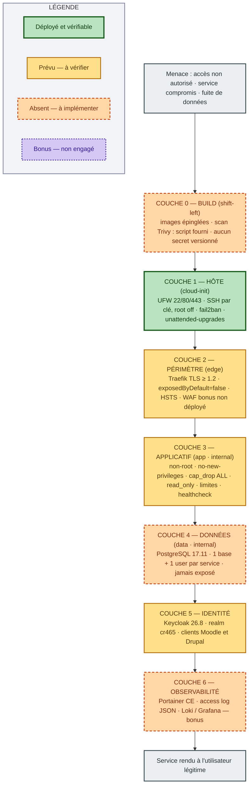

# Schéma 5 — Défense en profondeur

> **État au 19 octobre 2026.** Déployé et vérifié dans le dépôt : Traefik + un service de test
> (`whoami`). Tout le reste est une **cible** : les éléments non encore déployés sont en
> pointillé et signalés « non déployé ». Mettre ce schéma à jour à chaque ajout réel de service.

**Objectif** : montrer que la sécurité est répartie en couches indépendantes — un attaquant doit
réussir sept fois de suite.

## Les sept couches

| Couche | Contrôles | État vérifié |
|---|---|---|
| 0 — BUILD | Images épinglées, scan local, aucun secret versionné | **Script fourni**, rapport à produire |
| 1 — HÔTE | UFW 22/80/443, SSH par clé, root off, fail2ban, unattended-upgrades, sysctl, logs Docker bornés | **Déployé** (cloud-init) |
| 2 — PÉRIMÈTRE | Traefik TLS ≥ 1.2, `exposedByDefault=false`, HSTS, WAF bonus | **Partiel** (WAF absent) |
| 3 — APPLICATIF | non-root, `no-new-privileges`, `cap_drop: ALL`, `read_only`, limites, healthcheck | **Appliqué** dans le compose |
| 4 — DONNÉES | PostgreSQL jamais exposé, 1 base + 1 user par service | Cible |
| 5 — IDENTITÉ | Keycloak OIDC, rôles, MFA possible | Cible (non configuré) |
| 6 — OBSERVABILITÉ | Portainer, access log JSON, Loki/Grafana | Cible (absent) |

## Risque résiduel à documenter

- L'utilisateur `adminops` appartient au groupe `docker` : sur l'hôte, cela équivaut à **root**.
- Le socket Docker n'est **plus** monté dans Traefik : il passe par `docker-socket-proxy`
  en lecture seule (`POST: 0`), sur un réseau `socket` isolé.
- `whoami` n'a pas de healthcheck : image `scratch` sans binaire interne. Le healthcheck de
  Traefik et `scripts/test-routing.sh` couvrent la vérification.
