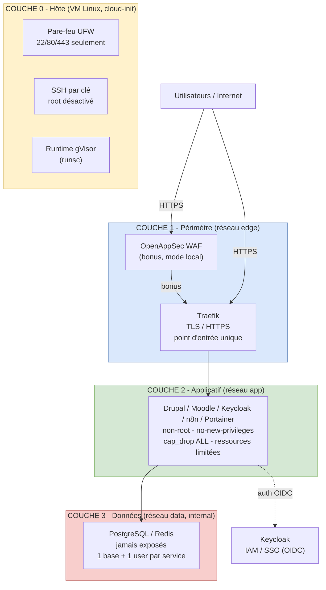

# Défense en profondeur — 4 couches de protection

> Schéma de synthèse sécurité : chaque couche est une barrière indépendante.
> C'est le schéma de référence pour la vidéo et le document de synthèse.

