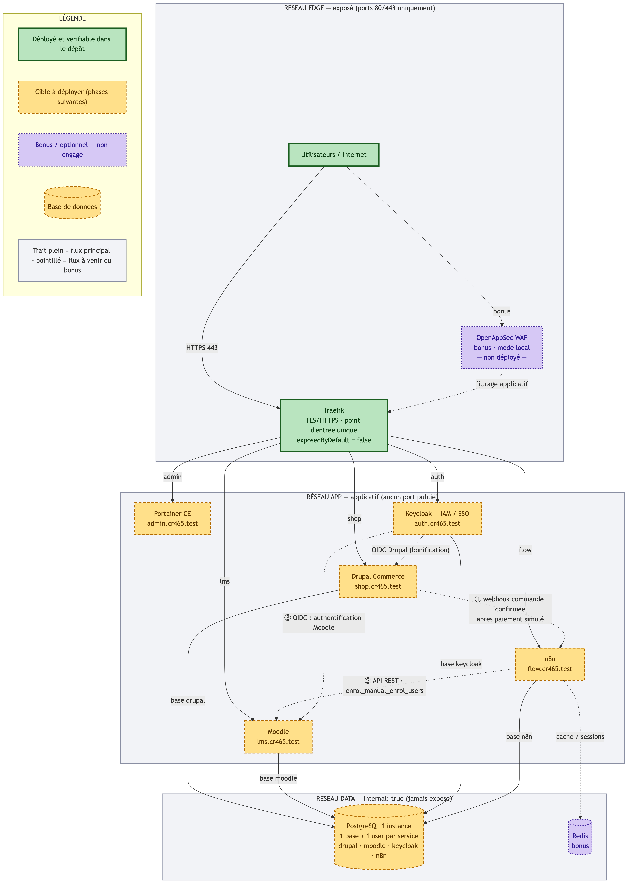
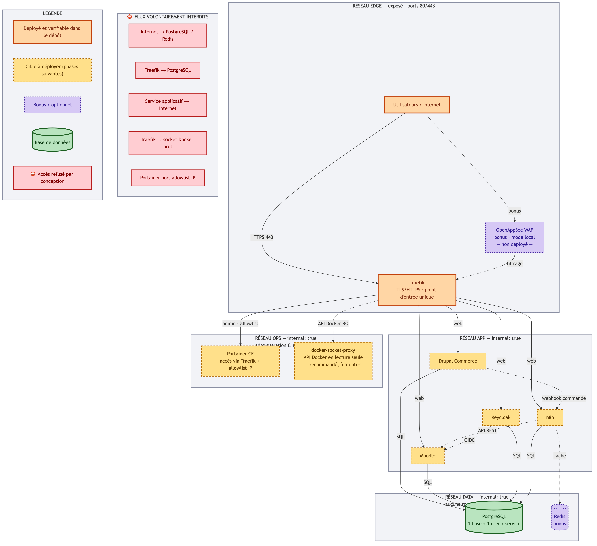
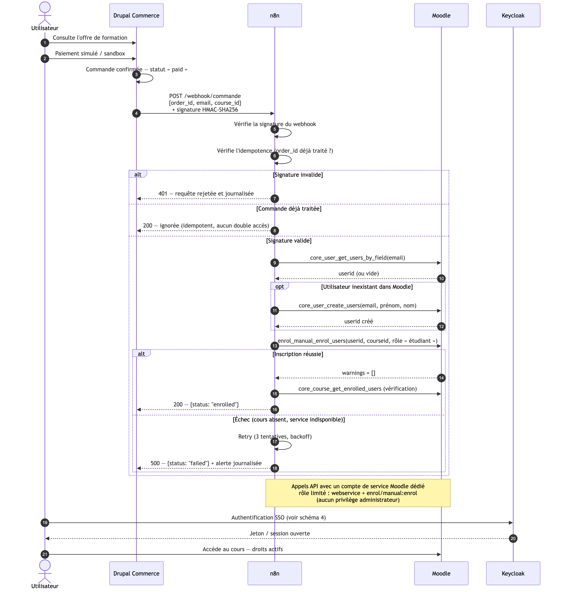
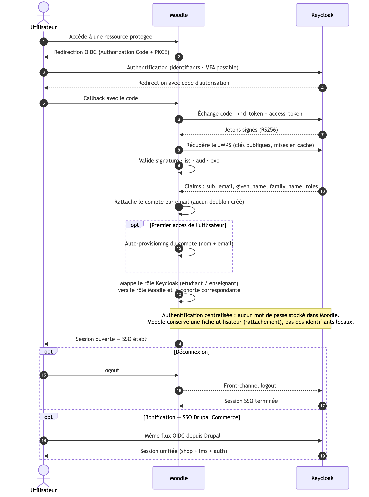
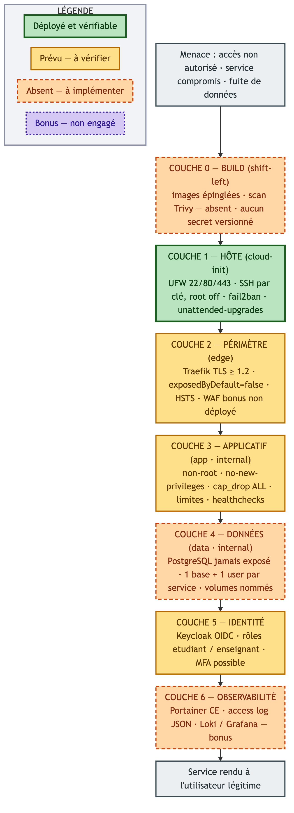

# Les 5 schémas d'architecture — guide de lecture

Cette page explique, en langage simple, les cinq schémas du projet. Elle sert de référence
commune : chaque membre doit pouvoir expliquer n'importe lequel d'entre eux.

> **Règle d'or** : un schéma qui montre plus que ce qui est réellement déployé est pénalisé.
> Les schémas utilisent donc un code couleur qui distingue le déployé du prévu.

---

## Vocabulaire minimal

| Terme | Définition simple |
|---|---|
| **Reverse proxy** (Traefik) | La porte d'entrée unique. Tout le trafic web passe par lui, il l'envoie vers le bon service. |
| **Réseau interne** | Un réseau Docker sans aucune connexion vers Internet : un conteneur qui s'y trouve ne peut pas « sortir ». |
| **SSO / OIDC** | Un seul compte pour toutes les applications. Keycloak est le guichet d'identité, Moodle et Drupal lui font confiance. |
| **Webhook** | Un appel automatique d'un service vers un autre, déclenché par un événement (ici : « commande payée »). |
| **Pointillé** | « Prévu, mais pas encore fait. » |

---

## 1. Architecture générale — la vue d'ensemble

**Ce que ça montre.** Le chemin complet d'un utilisateur : il arrive d'Internet en HTTPS,
traverse la porte d'entrée (Traefik), qui l'envoie vers le bon service selon le nom de
domaine — `shop.` pour la boutique, `lms.` pour les cours, `auth.` pour l'identité,
`flow.` pour l'automatisation, `admin.` pour la console d'administration. En bas,
PostgreSQL, jamais accessible depuis Internet : seuls les services applicatifs lui parlent.

**Ce que ça raconte.** Le parcours métier : l'utilisateur achète (①), un webhook prévient
n8n (②), n8n inscrit l'étudiant dans Moodle (③), et l'identification passe par Keycloak.

**Pourquoi c'est important.** C'est le premier schéma lu par le correcteur : il vérifie la
cohérence globale et que les bons services sont reliés.

---

## 2. Segmentation réseau — qui a le droit de parler à qui

**Ce que ça montre.** Quatre quartiers isolés :

- **EDGE** — la façade, seule zone visible d'Internet (ports 80/443).
- **APP** — les applications (Drupal, Moodle, Keycloak, n8n), sans porte vers l'extérieur.
- **OPS** — l'administration (Portainer, proxy Docker), isolée du reste.
- **DATA** — la base de données, enfermée.

Les flèches indiquent les seules conversations autorisées. Le panneau rouge liste les
**conversations interdites** : Internet ne parle jamais à la base, Traefik non plus,
un service applicatif ne sort jamais sur Internet.

**Ce que ça raconte.** Si un service est piraté, l'attaquant reste coincé dans son quartier.

**Pourquoi c'est important.** La grille pose explicitement la question « quels accès sont
volontairement interdits ? » — le panneau rouge y répond d'un coup d'œil.

---

## 3. Séquence d'intégration — l'achat qui donne accès au cours

**Ce que ça montre.** Les 18 étapes qui suivent un achat :

1. L'utilisateur choisit une formation et paie (paiement simulé).
2. Drupal prévient n8n par un webhook **signé** (HMAC-SHA256).
3. n8n vérifie que la commande n'a pas déjà été traitée (anti-doublon).
4. n8n retrouve — ou crée — le compte Moodle à partir du courriel.
5. n8n inscrit la personne au cours avec un **compte de service** à rôle limité.
6. En cas d'échec : trois tentatives, puis erreur journalisée.
7. L'utilisateur se connecte en SSO et accède au cours.

**Ce que ça raconte.** Le cœur fonctionnel, avec les sécurités attendues : authentification
du webhook, idempotence, moindre privilège, gestion d'erreur.

**Pourquoi c'est important.** C'est le critère « Intégration fonctionnelle » : c'est là que
se joue la démo crédible.

---

## 4. Séquence SSO — un seul mot de passe pour tout

**Ce que ça montre.** Comment un utilisateur se connecte à Moodle **sans** mot de passe
Moodle : Moodle le redirige vers Keycloak, Keycloak vérifie l'identité, puis renvoie un
jeton signé que Moodle contrôle avant d'ouvrir la session.

**Points clés ajoutés.** Vérification de la signature du jeton (JWKS, `iss`, `aud`, `exp`),
récupération des attributs (nom, courriel, rôle), rattachement au bon compte, et
déconnexion qui ferme aussi la session Keycloak.

**Précision importante.** On ne dit pas « aucun compte local dans Moodle » — c'est faux.
Moodle conserve une fiche utilisateur ; il ne stocke simplement **aucun mot de passe**.

**Pourquoi c'est important.** C'est le critère « IAM / SSO » : l'énoncé exige un SSO
fonctionnel entre Keycloak et Moodle.

---

## 5. Défense en profondeur — les sept portes à franchir

**Ce que ça montre.** Sept couches de protection, de la fabrication au fonctionnement :

| Couche | En clair |
|---|---|
| 0 — BUILD | Vérifier les images **avant** déploiement (versions figées, scan) |
| 1 — HÔTE | La machine : pare-feu, SSH par clé, mises à jour, anti-bruteforce |
| 2 — PÉRIMÈTRE | La porte d'entrée : HTTPS, point d'exposition unique |
| 3 — APPLICATIF | Les conteneurs : pas de root, pas d'escalade, ressources limitées |
| 4 — DONNÉES | La base : invisible de l'extérieur, un utilisateur par service |
| 5 — IDENTITÉ | Keycloak : qui es-tu, quel rôle as-tu |
| 6 — OBSERVABILITÉ | Voir ce qui se passe : journaux, états des conteneurs |

**Code couleur.** Vert = en place et vérifié · jaune = prévu · orange = absent aujourd'hui ·
violet = bonus non engagé.

**Ce que ça raconte.** Un attaquant doit réussir sept fois de suite : chaque couche suppose
que la précédente a échoué.

**Pourquoi c'est important.** C'est le schéma qui relie toutes les exigences de sécurité de
l'énoncé en une image, et il s'auto-évalue honnêtement.

---

## Phrase de synthèse (à réutiliser en présentation)

> « Nos cinq schémas racontent la même histoire sous cinq angles : une seule porte
> d'entrée, des quartiers étanches, un achat qui ouvre automatiquement l'accès, une
> identité unique, et sept couches de protection. Les zones en pointillé montrent
> honnêtement ce qui reste à construire. »

---

## Sources éditables

Les sources Mermaid des schémas corrigés sont conservées hors du dépôt
(dossier `schemas-corriges/` du poste de travail) et peuvent être réinjectées ici.
Chaque schéma du dépôt (`01-…md` à `05-…md`) contient déjà son bloc Mermaid.
