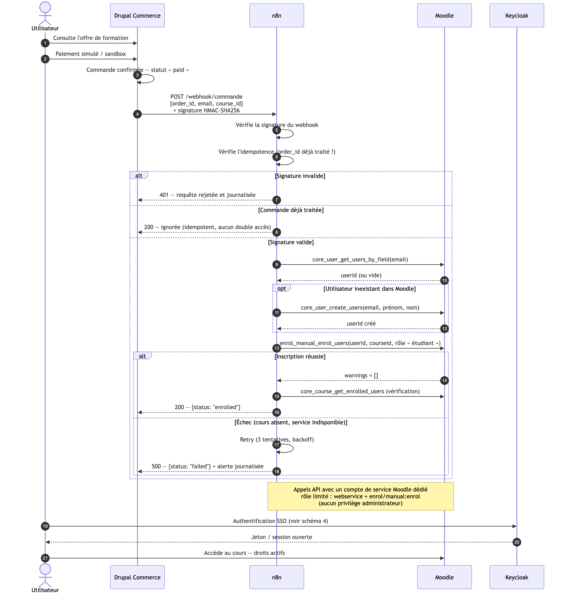

# Workflow n8n



## Rôle

n8n est la couche d'orchestration entre la **vente** (Drupal Commerce) et l'**accès**
(Moodle). Aucun code applicatif n'est nécessaire : le workflow est visuel et versionné
sous forme de JSON.

## Chaîne vérifiée

```
Drupal : commande → état « completed »
   │  webhook POST https://flow.cr465.test/webhook/commande
   │  {order_id, email, total, currency} + en-tête X-CR465-Signature (HMAC)
   │  → n8n recalcule le HMAC ; signature absente ou fausse = 401
   ▼
n8n : « Webhook commande »
   │
   ├─► « Chercher utilisateur Moodle » : core_user_get_users_by_field (username = email)
   │
   └─► « Inscrire au cours » : enrol_manual_enrol_users (userid, courseid, roleid=5)
   ▼
Moodle : apprenant inscrit au cours
```

## Compte de service Moodle (moindre privilège)

| Élément | Valeur |
|---|---|
| Service externe | `cr465`, protocole REST |
| Fonctions | `core_user_get_users_by_field`, `core_user_create_users`, `core_course_get_courses`, `core_course_get_enrolled_users`, `enrol_manual_enrol_users`, `core_webservice_get_site_info` |
| Compte | `svc-n8n`, authentification `webservice` (sans mot de passe) |
| Rôle | `servicen8n` : `enrol/manual:enrol`, `moodle/role:assign`, `moodle/user:viewalldetails`, `moodle/user:create`, `webservice/rest:use` |

**Aucun accès administrateur.** Le jeton est permanent mais stocké hors du dépôt.

## Preuve d'exécution

```
Commande 4 creee pour acheteur2@cr465.test — total 49.000000 USD
[notice] Commande 4 notifiee a n8n (HTTP 200).
[success] Commande 4 marquee completed

Moodle :
        email         | shortname  | status |        cree_le
----------------------+------------+--------+---------------------
 acheteur2@cr465.test | CR465-DEMO |      0 | 2026-10-19 06:32:27
```

## Difficultés résolues

1. `wsaccessusernologin` → plugin `auth_webservice` sur le compte de service.
2. Recherche par email renvoyant `[]` → recherche par `username` + `moodle/user:viewalldetails`.
3. `wsusercannotassign` → ligne dans `role_allow_assign` (matrice d'attribution des rôles).
4. Plusieurs workflows n8n actifs sur le même webhook → purge avant réimport.
5. Valeurs préfixées par `=` traitées comme expressions → passage en POST form-urlencoded.

Détail : `docs/operations/integration-n8n.md`.
